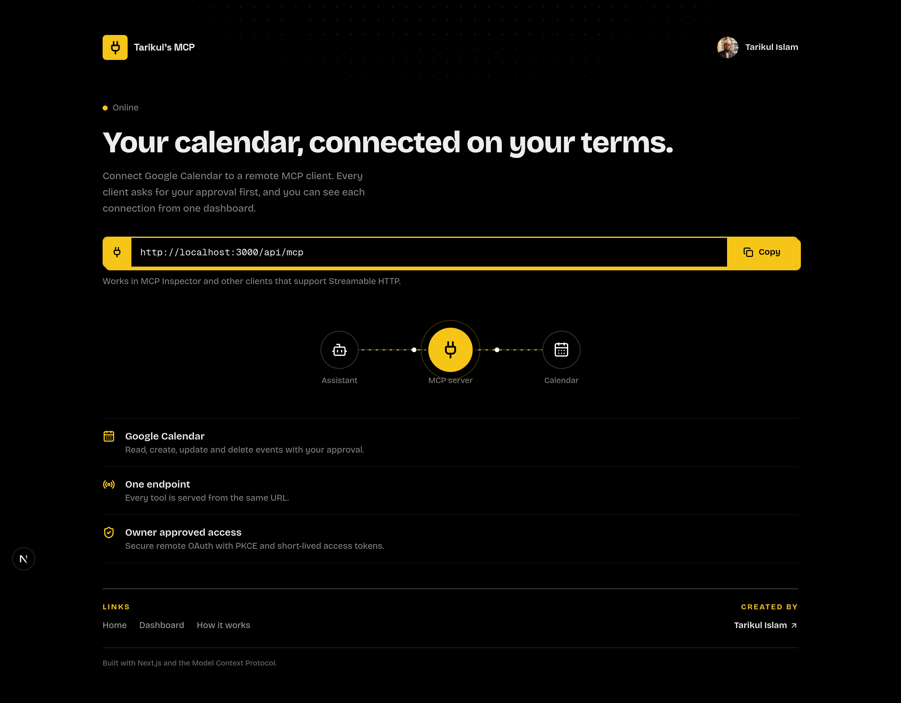
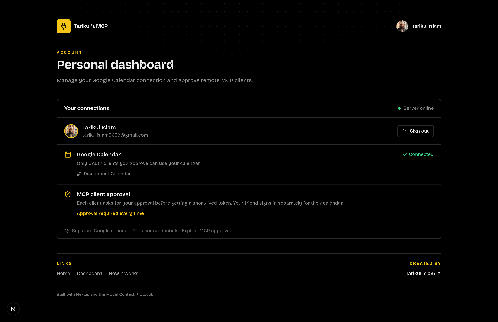

# Personal MCP Server

A remote [Model Context Protocol](https://modelcontextprotocol.io/) server that lets compatible AI assistants work with Google Calendar. Each person connects their own Google account, and each MCP client needs that account holder’s approval.





## Pages and links

- Website: <https://tarikuls-mcp.vercel.app>
- Dashboard: <https://tarikuls-mcp.vercel.app/dashboard>
- System documentation: <https://tarikuls-mcp.vercel.app/docs>
- Remote MCP endpoint: <https://tarikuls-mcp.vercel.app/api/mcp>
- Created by: <https://tarikul-islam.me/>

The homepage introduces the service and shows the MCP endpoint. The dashboard shows your Google account and connection status. The `/docs` page explains the connection, approval, and security flow.

## How it works

1. Sign in from the dashboard with Google and grant the server Google Calendar access.
2. Add the `/api/mcp` endpoint to an MCP client that supports Streamable HTTP and OAuth discovery.
3. Sign in with the Google account whose calendar you want the client to use.
4. Review the client name and account on the approval screen, then approve or deny access.
5. Ask the AI assistant to use the Calendar tools.

You and a friend can use the same server URL with separate Google accounts. Credentials are stored per account, and each access token is tied to one account. A client approved for one account cannot use another account’s calendar.

### Available tools

- `listCalendarEvents` — list the next 10 upcoming events.
- `findCalendarEventsByDate` — find an event date among those upcoming events.
- `getCalendarEvent` — retrieve an event by ID.
- `createCalendarEvent` — create an event, including attendees, reminders, recurrence, and other event options.
- `updateCalendarEvent` — update an existing event.
- `deleteCalendarEvent` — delete an event by ID.
- `ping` — check that the server is responding.

## Run locally

Requirements: Node.js, pnpm, a Google OAuth client, and a PostgreSQL database. This project uses Neon PostgreSQL by default.

Install dependencies and create `.env.local` in the project root:

```bash
pnpm install
```

```env
GOOGLE_CLIENT_ID="your_google_client_id"
GOOGLE_CLIENT_SECRET="your_google_client_secret"
GOOGLE_REDIRECT_URIS="http://localhost:3000/api/auth/callback"
GOOGLE_AUTH_URL="http://localhost:3000/api/auth/login"
DATABASE_URL="your_postgresql_connection_string"
MCP_AUTH_SECRET="use-at-least-32-random-characters"
MCP_BASE_URL="http://localhost:3000"
```

Initialize or upgrade the database schema, then start the app:

```bash
pnpm db:setup
pnpm dev
```

Open <http://localhost:3000>. The schema setup migrates an existing single-account Calendar connection into the per-account table. Keep `.env.local`, OAuth secrets, database credentials, and access or refresh tokens out of Git. `DATABASE_URL` and `MCP_AUTH_SECRET` must remain server-side.

Build the project with:

```bash
pnpm run build
```

## Google OAuth setup

1. Create or select a project in Google Cloud Console.
2. Enable the Google Calendar API.
3. Configure the OAuth consent screen and create a Web application OAuth client.
4. Add the exact callback URL to the authorized redirect URIs. Locally this is `http://localhost:3000/api/auth/callback`; in production use your HTTPS domain.
5. Set the environment variables above locally and in your hosting provider. Set `MCP_BASE_URL` to the public origin of the deployment.

## Connect a remote MCP client

Configure the client to use your server’s MCP endpoint:

```text
https://your-domain.example/api/mcp
```

The server publishes OAuth discovery metadata. An MCP client can use that to open the sign-in and approval flow. To inspect the endpoint during development, run:

```bash
pnpm dlx @modelcontextprotocol/inspector
```

OAuth authorization uses PKCE (S256). Authorization codes expire after five minutes and MCP access tokens expire after 15 minutes. The server does not issue MCP refresh tokens, so the client must authorize again when its access token expires.

## Accounts and access

- Each Google account has its own Calendar credentials and profile record.
- Every Calendar tool call uses the account identity from the verified MCP access token.
- A user must explicitly approve each MCP client authorization request for their account.
- Google credentials stay on the server and are not sent to the browser or MCP client.
- Dashboard sessions use signed, HttpOnly, SameSite cookies and expire after 12 hours.
- Disconnecting Calendar removes that account’s saved credentials and attempts to revoke its Google token.
- Anyone who can reach the public website can sign in and connect their own Google account. There is no invite-only email allowlist; users cannot access another account’s Calendar without that account’s authorization.

Use HTTPS in production. If any credentials are exposed, revoke or rotate them immediately.
